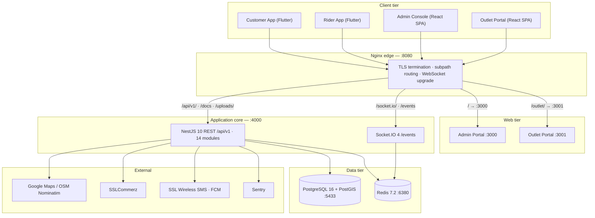
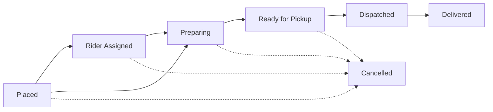
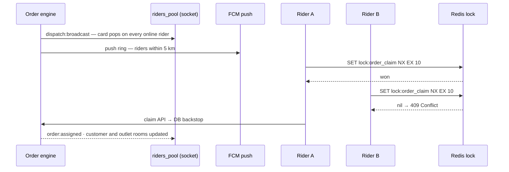
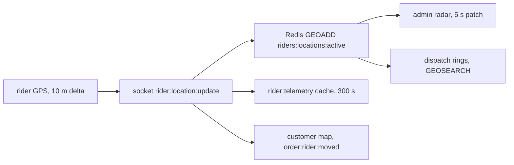

# DeliveryOS — Technical Deep Dive

Engineering companion to the [product tour](README.md) and the [interactive walkthrough](index.html). It covers the architecture, the algorithms behind the core flows, and the controls this project deliberately cares about.

The authoritative specs (BRD/TID/ADR suites) live in the engineering monorepo under `context_docs/`. This document condenses them; where the two disagree, the specs and the code win.

**Contents** —
[1 Architecture](#1-architecture-and-ingress) ·
[2 Layout & stack decisions](#2-layout-and-stack-decisions) ·
[3 Backend surface](#3-backend-surface) ·
[4 Data model](#4-data-model) ·
[5 Redis key map](#5-redis-key-map) ·
[6 Order lifecycle](#6-order-lifecycle) ·
[7 Mechanism playbook](#7-mechanism-playbook) ·
[8 Realtime protocol](#8-realtime-protocol-events) ·
[9 Security model](#9-security-model) ·
[10 Payments & finance](#10-payments-and-finance) ·
[11 Client architecture](#11-client-architecture) ·
[12 Design system](#12-design-system) ·
[13 Case studies](#13-case-studies) ·
[14 Testing](#14-testing-and-quality-gates) ·
[15 Operations](#15-operations) ·
[16 Dev runbook](#16-dev-runbook) ·
[17 Specs & ADR index](#17-specs-and-adr-index)

---

## 1. Architecture and ingress



| Public path (:8080) | Upstream | Notes |
| :--- | :--- | :--- |
| `/` | Admin `:3000` | Session keys `deliveryos_admin_*` |
| `/outlet/` | Outlet `:3001` | Namespaced `deliveryos_outlet_*` — both portals coexist in adjacent tabs |
| `/api/v1/` | API `:4000` | Swagger at `/docs`, non-production only |
| `/uploads/` | API `:4000` | Local-disk media, 5 MB image cap |
| `/socket.io/`, `/events` | API `:4000` | WS upgrade proxied (ADR-021) |

One edge, one TLS certificate, no cross-origin anything. Environments differ only in compose file and posture:

| | Dev | Production |
| :--- | :--- | :--- |
| Compose | `deploy/docker-compose.yml` | `deploy/docker-compose.prod.yml` |
| TLS | none (localhost) | Let's Encrypt, auto-renewed |
| Processes | root-in-docker, 6 containers | non-root (`node`, `nginx-unprivileged`) |
| Forbidden modes | — | mock SMS, static OTP, sandbox gateway, Swagger — **boot refuses** |

---

## 2. Layout and stack decisions

```text
DeliveryOS/
├── apps/
│   ├── admin_portal/       React 18 · Vite · Tailwind · Zustand · TanStack Query · Leaflet OSM
│   ├── outlet_portal/      React 18 · Vite · Tailwind · Web Audio (KDS chime)
│   ├── customer_app/       Flutter · Riverpod 3 · Dio · socket_io_client
│   └── rider_app/          Flutter · Riverpod 3 · background GPS foreground service
├── services/backend_api/   NestJS 10 · TypeScript strict · Prisma 5 · Socket.IO 4
├── deploy/                 compose (local + prod) · nginx · systemd backup units
└── context_docs/           BRD / TID / ADR suites
```

Three decisions worth explaining; the rest of the layout follows convention:

- **No shared packages between apps.** Each app owns its `core/` (tokens, network, utils). Extracting anything cross-app requires an ADR. Four release trains should not be coupled by a convenience import.
- **GPS telemetry never enters PostgreSQL** (ADR-003). Postgres holds static coordinates (outlets, saved addresses); live courier positions live and die in Redis. Ticks are high-volume, low-value, and would bloat the primary datastore for no query benefit.
- **Two SPAs, not one** (ADR-005). Outlet staff and platform operators never load each other's code, sessions are namespaced, and either portal deploys independently behind its subpath.

---

## 3. Backend surface

Fourteen NestJS modules:

| Module | Prefix | Responsibility |
| :--- | :--- | :--- |
| Auth | `/auth` | OTP issue/verify, JWT pair, rotation, logout, FCM device tokens |
| Orders | `/orders` | Checkout, reorder validation, history, tracking payload, cancel, switch-to-COD, stale reaper |
| Outlet Staff | `/outlet` | KDS feed, accept/reject/ready/handover, stock toggles, hours, sales ledger |
| Riders | `/rider` | Duty toggle + in-flight lock, claim/pickup/deliver, trips, earnings, COD deposits |
| Dispatch | settings | Broadcast engine, escalation scanner, stale TTL, takeaway bypass |
| Outlets | `/outlets` | PostGIS discovery (`nearby`, `search`, catalog), coverage validation |
| Promotions | `/banners`, `/coupons` | Banners with deeplinks, coupon validation, fee engine |
| Payments | `/payments` | Gateway sessions, HMAC webhooks, callbacks |
| Realtime | `/events` | Socket.IO gateway — rooms, telemetry ingestion |
| Admin | `/admin` | 61 governance routes — analytics, fleet, orders, CRUD, settings, finance |
| Addresses | `/customers` | Saved-location CRUD, profile |
| Geo | `/geo` | Nominatim reverse geocode, 24 h cache |
| Notifications | — | FCM multicast |
| Health | `/health` | PostgreSQL + Redis liveness |

Conventions that hold everywhere:

```jsonc
// response envelope (TransformInterceptor + AllExceptionsFilter)
{ "success": true, "statusCode": 200, "message": "…", "data": { } }
```

- Every money or state mutation runs in one Prisma transaction — the row and its ledgers commit or roll back together.
- Global throttle 100 req/min; tighter budgets on OTP, webhook, and geo endpoints.
- Winston JSON logs with `x-request-id` correlation; Sentry on unexpected 5xx.
- Boot-time Joi validation of required env (`DATABASE_URL`, `REDIS_URL`, `JWT_SECRET`, `JWT_REFRESH_SECRET`, each secret ≥ 32 chars).

---

## 4. Data model

Twenty-three Prisma models (`prisma/schema.prisma`; TID-02 has the full catalog). Grouped:

| Group | Contents |
| :--- | :--- |
| Identity | `User` (4 roles), staff assignments with `PermissionScope`, device tokens |
| Taxonomy | `OutletCategory` — admin-managed, M2M memberships, icon, visibility |
| Catalog | `Brand → Outlet → MenuCategory → Product → ProductVariant`, absolute pricing (ADR-017) |
| Orders | `Order`, line items, immutable JSONB snapshots of address and variants (ADR-008/023) |
| Promotions | `Banner` (4 link types), `Coupon` (usage counters) |
| Finance | commission ledger, rider trip ledger, settlements, cash deposits |
| Ops | `SystemSetting` (typed JSON), `MediaAsset`, operating hours |

Domain vocabulary (enums) — one read covers most of the business rules:

```typescript
enum UserRole          { SUPER_ADMIN, OUTLET_ADMIN, RIDER, CUSTOMER }
enum AccountStatus     { PENDING_APPROVAL, ACTIVE, SUSPENDED }
enum PermissionScope   { PARTICULAR_OUTLET, ALL_OUTLETS_MASTER }
enum OrderFlowMode     { RIDER_FIRST, OUTLET_FIRST }
enum OrderStatus       { PLACED, RIDER_ASSIGNED, ACCEPTED, PREPARING, READY_FOR_PICKUP,
                         DISPATCHED, DELIVERED, CANCELLED }      // ACCEPTED deprecated (ADR-002)
enum PaymentMethod     { CASH_ON_DELIVERY, ONLINE_GATEWAY }
enum PaymentStatus     { PENDING, PAID, REFUNDED, FAILED }
enum SettlementStatus  { PENDING, PROCESSING, SETTLED }
enum CashDepositStatus { PENDING_APPROVAL, APPROVED, REJECTED }
enum DiscountType      { PERCENTAGE, FLAT }
enum BannerLinkType    { OUTLET, CATEGORY, EXTERNAL, INTERNAL }
```

Invariants:

- Money is `DECIMAL(10,2)` with `Math.round(x * 100) / 100` rounding (ADR-009). No floats on money paths.
- Coordinates are plain `Float` columns; geography is computed at query time over expression GIST indexes (§7.5).
- History cannot be rewritten: checkout freezes address/variant snapshots, and ledger rows are FK-immutable, soft-deleted only (ADR-022).
- Migration history is a single `0_init` baseline (ADR-025) — fresh-system posture, regenerated via `prisma migrate diff`, drift-checked.

---

## 5. Redis responsibilities

What Redis carries, grouped by responsibility. The mechanisms are illustrated in §7; the exact key inventory is internal operations detail and stays in the engineering runbook.

| Responsibility | Shape | Lifetime |
| :--- | :--- | :--- |
| Dispatch claim mutex | one lock per claimable order (`SET NX EX`, §7.3) | 10 s |
| Rider in-flight marker | one flag per courier carrying a trip (duty lock, busy check) | trip duration |
| Live courier positions | GEO set over online riders (`GEOADD` / `GEOSEARCH`) | while on duty |
| OTP lifecycle | per-phone code, send-rate counter, strike counter (§9.1) | 120 s |
| Refresh-token revocation | per-jti flags for rotated/revoked tokens (§9.2) | token life |
| JWT-guard user cache | short-lived user lookup, purged on logout | 30 s |
| Background-sweep leader locks | per-task mutex so one replica sweeps at a time | 25–55 s |
| Escalation idempotency | per-order, per-tier flags (§7.2) | 1 h |
| Tracking caches | per-order location, per-rider telemetry | 300 s |
| Daily order-number counter | per-day `INCR` → `ORD-YYYYMMDD-NNNN` | 48 h |
| Reverse-geocode cache | rounded-coordinate keyed | 24 h |
| Active-orders read model | versioned snapshots behind `GET /orders/active?ver=` (ADR-026, §7.10) | TTL + reconcile sweep |

---

## 6. Order lifecycle

Transition table from `order-state.machine.ts` (ADR-002):

| From | Allowed |
| :--- | :--- |
| `PLACED` | `RIDER_ASSIGNED`, `PREPARING`, `CANCELLED` |
| `RIDER_ASSIGNED` | `PREPARING`, `READY_FOR_PICKUP`, `CANCELLED` |
| `PREPARING` | `READY_FOR_PICKUP`, `CANCELLED` |
| `READY_FOR_PICKUP` | `DISPATCHED`, `CANCELLED` |
| `DISPATCHED` | `DELIVERED`, `READY_FOR_PICKUP` (return-to-store edge) |
| `DELIVERED`, `CANCELLED` | terminal |



Rules that matter:

- Outlet acceptance jumps straight to `PREPARING` and stamps `acceptedAt`.
- Claimable states depend on the per-order flow-mode snapshot: `RIDER_FIRST` → `PLACED`, `OUTLET_FIRST` → `READY_FOR_PICKUP`.
- Customers may self-cancel only before preparation starts. Anything later requires admin force-cancel with a ≥5-character audit reason.

Flow modes, chosen per outlet:

| Mode | Couriers called | Store starts | Fits |
| :--- | :--- | :--- | :--- |
| `RIDER_FIRST` (Zero Waste) | right after payment | after a courier claims | hot food |
| `OUTLET_FIRST` (Traditional) | at `READY_FOR_PICKUP` | immediately | grocery, retail |

---

## 7. Mechanism playbook

How the core flows actually work. Each card: the mechanism, then the guarantees it buys.

### 7.1 Checkout — one ACID boundary

```text
POST /orders
├─ ① pre-checks (read-only)
│    outlet open?       region-time hours gate (§7.9)
│    outlet not busy?   rush-pause flag
│    address covered?   ST_DWithin (§7.5)
│    subtotal in range? outlet min · system min/max
│
├─ ② single Prisma $transaction
│    a. orderNumber    Redis INCR order:seq:<YYYYMMDD>
│    b. Order.create   status PLACED · flow-mode snapshot · address JSONB frozen
│    c. line items     variant snapshots · unit prices frozen
│    d. coupon claim   UPDATE coupons
│                      SET   current_uses = current_uses + 1
│                      WHERE id = ? AND current_uses < usage_limit
│                      0 rows → rollback
│    e. delivery fee   fee engine (§7.8), config-cached
│
└─ ③ after commit
     ONLINE → gateway session; dispatch suppressed until verified IPN
     COD    → order claimable per its flow mode
     emit   order:new to outlet/brand rooms · read-model version bump
```

Failure at any step in ② rolls the whole order back. There is no state in which a coupon is consumed without an order, or an order exists with an unclaimed coupon.

### 7.2 Order broadcast — the dispatch ladder



Escalation — an order is never left floating:

| Clock | Event | Mechanism |
| :--- | :--- | :--- |
| T+0 | broadcast | socket pool + FCM ring 5 km |
| claim window | rider taps | mutex race, §7.3 |
| search timeout | no taker → tier 2 | 30 s leader-locked sweep, key `dispatch:escalated:<id>:tier2`, ring 6 km |
| next timeout | still nothing → tier 3 | ring 10 km, pool-wide push |
| stale TTL (default 60 min) | auto-cancel | full rollback (§7.6) and refund |

Candidate eligibility, evaluated per rider per ring:

```text
eligible(rider, order):
    duty == ONLINE
    AND NOT EXISTS rider:active_order:<riderId>
    AND accountStatus == ACTIVE
    AND cashInHand <= cashLimit
    AND haversine(outlet.gps, rider.gps) <= ring
```

The socket broadcast is pool-wide; only the FCM push is geo-ringed. Takeaway orders skip the ladder entirely on their `deliveryMethod` snapshot.

### 7.3 The claim race

```text
Rider A → SET lock:order_claim:<id> "riderA" NX EX 10   → OK    winner
Rider B → SET lock:order_claim:<id> "riderB" NX EX 10   → nil   loser → 409

winner → $transaction:
           order.update(status → RIDER_ASSIGNED, riderId)   guarded: still claimable
           SET rider:active_order:<riderId>
```

`NX` makes the winner unique across the cluster. `EX 10` means a winner that crashes cannot block the order indefinitely. The guarded update inside the transaction is the backstop for anything the 10-second window misses.

### 7.4 Distance — three engines, one truth

Haversine, used where a round-trip would be wasteful:

```text
a = sin²(Δφ/2) + cos φ₁ · cos φ₂ · sin²(Δλ/2)
d = 2R · asin(√a)          R = 6371 km
```

| Engine | Used for | Why |
| :--- | :--- | :--- |
| in-memory haversine | customer distance chips · force-assign courier ranking · ring math | instant; the admin UI mirrors the backend ranking |
| PostGIS `ST_DWithin` / `ST_Distance` | nearby feed · coverage validation · discovery sort | authoritative radius truth, index-backed |
| Redis GEO | live courier positions · ring candidate queries | sub-ms over hot telemetry |

Display distances are straight-line. ETA is separate math: distance over average courier speed with a configured fallback. Location churn is deduped at 4-decimal precision (~11 m) before any cache write.

### 7.5 Geospatial anatomy

The radius query behind discovery and coverage checks:

```sql
SELECT id, name,
       ST_Distance(o.geog, :customer_geog) AS meters
FROM outlets o
WHERE ST_DWithin(o.geog, :customer_geog, :radius_meters)
ORDER BY meters;

-- o.geog is computed at query time from the Float columns:
--   ST_SetSRID(ST_MakePoint(longitude, latitude), 4326)::geography
```

Index that makes it fast (migration `20260924065308`):

```sql
CREATE INDEX … USING GIST (ST_SetSRID(ST_MakePoint(longitude, latitude), 4326));
```

The expression index keeps columns Prisma-friendly while radius lookups stay index-driven. `::geography` gives spheroid math in meters; SRID 4326 is the WGS84 GPS standard.

One GPS tick's path:



PostgreSQL is deliberately absent from that path. Reverse geocoding goes through Nominatim with a 24 h cache keyed at 4-decimal precision, and coverage validation always runs `ST_DWithin` on raw coordinates — never on a saved-address id that could later be edited.

### 7.6 Cancellation and financial rollback

One transaction, in order:

```text
① delete unbilled commission and trip ledgers
② restore coupon quota          current_uses − 1
③ release Redis locks           lock:order_claim:<id> · rider:active_order:<riderId>
④ payment → REFUNDED / FAILED   gateway Refund API, refund_id persisted
⑤ emit order:cancelled + order:status:changed to all rooms
```

Actors and gates: customers only before `PREPARING`; outlets reject with structured codes (`OUT_OF_STOCK`, `STORE_OVERLOAD`, `STORE_CLOSING_SON`, `OTHER`); admins any time, with the mandatory audit reason.

### 7.7 Settlement — the net COD offset

```text
outletPayout = Σ (orderTotal − commission)
riderNetPay  = max(0, deliveryEarnings − codCollected)
```

Worked example:

```text
earnings ৳80 · COD collected ৳1,240
riderNetPay = max(0, 80 − 1,240) = ৳0
the courier already holds ৳1,160 of platform cash
→ hub deposit → admin approval → cashInHand decremented atomically
```

The offset is what stops a settlement batch from paying cash to a courier who is already holding that cash. Deposit submission rejects with 409 while one is pending approval, and the balance only moves inside the approval transaction.

### 7.8 Delivery-fee engine

```text
FIXED_FLAT       fee = flatFee

DISTANCE_TIERED  fee = baseFee + max(0, distanceKm − baseKm) × perKmRate

example: ৳50 base / first 1.5 km · ৳20 per extra km · 4.2 km trip
         fee = 50 + (4.2 − 1.5) × 20 = ৳104
```

Configuration is a `SystemSetting` row, normalized to canonical camelCase on read (`normalizeDeliveryFeeConfig`). Rider payout share, average speed, and fallback ETA come from `delivery_economics`; a settings PATCH invalidates the pricing cache so the next order picks up the new split.

### 7.9 Region-time operating-hours gate

```text
now    = ZonedNow(region)            Asia/Dhaka | Asia/Riyadh — never the server clock
window = outlet.hours[now.weekday]

same-day window    open ≤ t < close
overnight window   close < open → open ≤ t OR t < close   // wraps midnight
```

Applied at checkout, at the KDS, and for discovery badges. Overnight windows and date rollover are pinned by unit tests against both zones.

### 7.10 Versioned read model (ADR-026)

```text
GET /orders/active?ver=<client-version>
  equal  → 204 No Content            zero database work
  lower  → 200 + snapshot + new version
  miss   → Postgres truth, repopulate

writes: order create/transition choke points bump version and snapshot (TTL)
healing: leader-elected reconcile sweep rebuilds from Postgres
client: render cached snapshot instantly → reconcile on resume (15 s throttle)
        → refetch on socket events → 60 s poll only while disconnected
```

App-resume discovery used to query the orders table on every foreground. It is now one versioned cache probe in the common case.

---

## 8. Realtime protocol (`/events`)

Socket.IO 4, JWT-authenticated handshake, namespace `/events`. Rooms join automatically on connect; `order:join` is verified per caller (§9.3).

| Room | Occupants | Carries |
| :--- | :--- | :--- |
| `user_{userId}` | customer session | progress, cancellation, payment events |
| `order_{orderId}` | opt-in, verified | tracking telemetry |
| `outlet_{outletId}` · `brand_{brandId}` | store staff | KDS chime, board invalidation |
| `rider_{riderId}` · `riders_pool` | couriers | dispatch broadcasts, deposits |
| `admin_hq` · `admin_fleet` | operators | radar feed, escalations |

| Direction | Events |
| :--- | :--- |
| client → server | `order:join` (ack `order:joined`) · `order:leave` (ack `order:left`) · `rider:location:update` |
| server → client | `connected` · `error` · `order:new` · `order:status:changed` · `order:rider:moved` · `order:cancelled` · `order:payment:verified` · `order:assigned` · `dispatch:broadcast` · `dispatch:escalated` · `order:delivery_failed` · `rider:location` · `outlet:status:changed` · `cash:deposit:submitted` · `cash:deposit:updated` |

Telemetry contracts: rider GPS streams on ~10 m deltas over the socket with a 30 s HTTP fallback; the admin radar patches its cached fleet on a 5 s throttle instead of refetching; the customer app reference-counts its socket — connected only while an order runs or tracking is open. Multi-replica fan-out runs through the Socket.IO Redis adapter (ADR-015).

---

## 9. Security model

The posture is fail-closed and least-privilege: weak configuration refuses to boot, every privileged action crosses a guard, and money moves only inside verified transactions. What follows are the controls this project actually leans on — not a generic checklist.

### 9.1 Identity — no passwords exist

```text
request OTP   3 per 5 min per phone (429 beyond)
              6-digit code · TTL 120 s · provider SMS
verify        5 wrong attempts invalidate the code
              success → access JWT (15 min) + refresh JWT (30 d, unique jti)
new phones    role_req:<phone> binds the requested onboarding role
```

There is no credential database to dump or phish. The dev-mode static OTP exists only behind an env gate, and a production boot refuses to start while it is enabled.

### 9.2 Session theft containment (ADR-020)

```text
refresh(jwt):
  jti revoked       → 401            logout was propagated
  jti already used  → reuse detected → revoke the entire family → 401
  fresh             → rotate: revoke old jti, mint a new pair
```

A leaked access token has a 15-minute blast radius. Replaying a rotated refresh token is treated as theft and kills the whole session family — the attacker and the victim both land at the login screen, which is the correct outcome. Mobile stores tokens in Keystore/Keychain via `flutter_secure_storage`; each portal keeps its own namespaced storage. Logout is server-side: the jti is revoked and the `auth:user` cache purged, so sessions actually die.

### 9.3 Authorization boundaries

| Capability | SUPER_ADMIN | OUTLET_ADMIN | RIDER | CUSTOMER |
| :--- | :---: | :--- | :---: | :---: |
| governance, finance, settings | ✓ | — | — | — |
| outlet KDS, catalog, ledger | ✓ | own scope only | — | — |
| claim and fulfill assigned trips | — | — | ✓ | — |
| own orders: place, track, cancel | — | — | — | ✓ |

HTTP: `JwtAuthGuard` then `RolesGuard` (`@Roles()`) on every route; outlet staff resolve further through `PermissionScope` — one branch, or all branches of a brand.

Realtime is a second, independent boundary. Joining `order_<id>` verifies the caller against that order (owner, assigned rider, outlet/brand scope, or super admin) before the join is granted; denials get an explicit error event. A valid JWT alone does not get a socket into anyone's room.

### 9.4 Payment trust boundary

- Webhooks verify HMAC-SHA256 over the raw body. Mismatch is a forgery and is dropped.
- Processing is idempotent: unique gateway transaction ID, row lock, and an atomic conditional `PENDING → PAID` update. Replays return success with zero side effects.
- Online-paid orders suppress dispatch and store alerts until verification completes — no service is ever rendered on unverified money.
- Refunds execute through the gateway API with `refund_id` persisted, giving an end-to-end audit trail from cancellation to money returned.

### 9.5 Financial integrity

Cross-references §7, stated here as controls: double-entry ledgers committed in the same transaction as the state change (ADR-009); ledger rows FK-immutable and soft-deleted only (ADR-022); `DECIMAL(10,2)` with deterministic rounding on every money path; COD cash stays in courier custody until the admin-approval transaction moves it (§7.7).

### 9.6 Races and abuse

| Vector | Control |
| :--- | :--- |
| concurrent trip claims | `SET NX EX` mutex + DB backstop (§7.3) |
| coupon oversell | conditional `UPDATE … WHERE current_uses < usage_limit` inside checkout (§7.1) |
| webhook replay | signature + idempotent atomic claim (§9.4) |
| traffic abuse | 100 req/min global; tighter budgets on OTP, webhook, geo |
| malicious uploads | SUPER_ADMIN-only multipart, image-type allowlist, 5 MB cap |

### 9.7 Hardened defaults

Helmet headers; origin-whitelisted CORS covering both HTTP and Socket.IO; Swagger and debug surfaces exist only outside production; containers run as non-root users; TLS terminates at the edge with automated renewal. None of these are configurable off in production — the boot-time Joi gate refuses to start with insecure settings present.

### 9.8 Recovery

Backups run on a timer with an offsite option (S3/rclone) and 7-day retention; restores are confirmation-gated and verified against the live database before being trusted. Every request carries `x-request-id` for cross-service correlation, and Sentry captures unexpected 5xx across all five deployables.

---

## 10. Payments and finance

Gateway strategy (ADR-011): SSLCommerz for live traffic (Session, Validation, Refund APIs), a sandbox gateway with HMAC-signed webhooks for development, and COD. Legacy stub adapters were removed rather than maintained dead — one real integration beats three fake ones.

Mechanisms live in the playbook: webhook verification and idempotency (§9.4), rollback on cancellation (§7.6), settlement with the COD offset (§7.7), fee engine (§7.8). Payment-failure rescue is a customer-facing one-tap switch to COD (`POST /orders/:id/switch-cod`) after the expiry sweep claims the stuck payment. Statements export as RFC 4180 CSV for ERP import.

---

## 11. Client architecture

**Portals — React 18 + Vite**

- Dual-store split (ADR-006): TanStack Query holds server state, Zustand holds session; a hook maps socket events to cache invalidation, so dashboards converge on truth without manual refetching.
- Outlet SPA mounts at `/outlet/` with isolated session storage (ADR-005) — both portals coexist in adjacent tabs.
- KDS chime is synthesized with Web Audio oscillators (D5 587 Hz + A5 880 Hz): no audio assets, and it stops only when the New lane is clear (ADR-007).

**Flutter apps**

- Feature-first layout — `lib/features/<domain>/{domain, presentation, providers}`; Riverpod 3 notifiers keep business state out of widgets.
- Localization sentinels: providers emit `@key|param`, resolved at render; parity tests enforce identical key sets across `en`/`bn`/`ar`.
- Customer app consumes the §7.10 read model and reference-counts its tracking socket.
- Rider app streams telemetry from an Android foreground service / iOS background location and tears GPS down on logout.
- Token refresh is single-flight in all four clients — a 401 storm cannot stampede the auth endpoint.

---

## 12. Design system

One spec (`DESIGN.md`, ADR-027) drives all four frontends: signature accents per app (Admin indigo, Outlet amber, Customer orange, Rider teal), shared neutrals, Light/Dark/System themes everywhere, flat hairline surfaces, a 4 px spacing grid, and tabular figures on numeric surfaces. Enforcement is not a convention — `scripts/check-design-system.mjs` fails CI in `npm run verify` on raw hex colors, inline styles, non-token shadows, or arbitrary font sizes, and token-parity tests pin both themes per app.

---

## 13. Case studies

Failure modes the architecture was specifically shaped around:

| Failure mode | Mechanism | Outcome |
| :--- | :--- | :--- |
| two couriers accept the same trip | §7.3 mutex + backstop | one winner; the other gets a clean 409 |
| coupon oversell under concurrency | §7.1 conditional update | oversell rolls back the entire checkout |
| forged or replayed webhooks | §9.4 HMAC + idempotent claim | dropped or deduplicated |
| app-resume order discovery hammering the DB | §7.10 versioned read model | 204 probe in the common case |
| store hours wrong across timezones | §7.9 region wall-clock | overnight windows and rollovers correct |
| menu edits rewriting order history | §7.1 snapshots + ADR-022 | receipts immutable |
| map licensing cost on the ops radar | Leaflet + OSM | no per-load fees |
| duplicate background jobs at replica scale | leader-locked sweeps | one sweeper per task |
| stolen refresh token | §9.2 rotation + reuse detection | session family revoked |
| order stuck between dispatch rings | §7.2 escalation + stale TTL | resolves to claimed or refunded |

---

## 14. Testing and quality gates

`npm run verify` at the root mirrors CI (`.github/workflows/ci.yml`):

```
test-integrity guard
├── backend   typecheck → ESLint → Jest unit → build
├── admin     typecheck → Vitest → build
├── outlet    typecheck → Vitest → build
├── customer  flutter analyze → flutter test
└── rider     flutter analyze → flutter test
```

| Suite | Scale | Pins |
| :--- | :--- | :--- |
| Backend unit | 350 tests, 24 suites, per-file coverage floors | FSM transitions · dispatch routing (unpaid withholding, takeaway bypass, both modes) · claim mutex · escalation idempotency · region-time hours · coupon caps · webhook atomicity · fee engine · OTP and token auth · RBAC guards · geocoding |
| Admin portal | 198 Vitest tests | auth store · i18n key symmetry · fleet filters · lifecycle filters · media math |
| Outlet portal | 48 Vitest tests | KDS resilience · store resolution · locale parity |
| Flutter (×2) | full suites | providers · cart conflicts · fulfillment steps · design tokens |
| Integration | 19 chained live-stack suites (`npm test`) | auth/RBAC · discovery · checkout · dispatch mutex · WebSocket · payments/IPN · settlements · cancellation · business integrity · e2e lifecycle with ledger audit |

The test-integrity guard bans `.skip`/`.only`/tautological assertions and hollowed suites, and enforces per-area test-count floors — weakening tests to get CI green is itself a CI failure.

---

## 15. Operations

- Logging: Winston JSON with `x-request-id` correlation; a global exception filter attaches request context to stack traces.
- Errors: Sentry, env-gated, across backend, both portals, both apps (ADR-014).
- Liveness: `/health` probes PostgreSQL and Redis.
- Backups: scripted, offsite option, 7-day retention, systemd timers; restore is confirmation-gated and verified live.
- Scale-out (ADR-015): Socket.IO Redis adapter for multi-replica fan-out, leader locks instead of a scheduler, de-pinned container names, 30 s JWT-guard user cache.
- Releases: `scripts/build-android.sh` produces dart-define-injected release AABs with `key.properties` signing.

---

## 16. Dev runbook

```bash
./scripts/start-local.sh --docker        # full stack → http://localhost:8080
```

| Task | Command |
| :--- | :--- |
| CI-identical gate | `npm run verify` (root) |
| integrity guard only | `npm run verify:tests` |
| rebuild + reseed DB | `npm run db:reset` (in `services/backend_api`) |
| integration suites | `npm test` (live stack required) |
| unit tests | `npm run test:unit` (backend or portal; no infra) |
| release AAB | `./scripts/build-android.sh customer\|rider` |
| backup / restore | `./scripts/backup-db.sh` / `./scripts/restore-db.sh` |

Ports: API `:4000` · admin `:3000` · outlet `:3001` · edge `:8080` · PostgreSQL `:5433` · Redis `:6380`.
Demo accounts: one seeded login per role — credentials ship with the evaluation package, not in this document.
Seed: 6 brands / 12 outlets with mixed flow modes, ~114 orders across every FSM state with complete financial books, coupons including expired and exhausted cases.

---

## 17. Specs and ADR index

The engineering monorepo keeps code and specs in lockstep through a three-phase protocol (Plan & Grounding → Implementation → Verify & Sync). BRD-00…07 cover product and personas; TID-01…07 cover architecture, schema, API catalog, WebSocket protocol, FSM and dispatch, client architecture, and deployment. `FEATURES.md` is the line-level capability catalog; `CHANGELOG.md` tracks SemVer releases and the roadmap.

| ADR | Decision |
| :--- | :--- |
| 001 | Modular monorepo + Nginx edge ingress |
| 002 | Dynamic dual order-flow state machine |
| 003 | PostGIS spatial engine + Redis geohash telemetry |
| 004 | Atomic dispatch claim mutex |
| 005 | Micro-frontends + subpath reverse proxy |
| 006 | Dual-store frontend paradigm + WebSocket invalidation |
| 007 | Web Audio synthesized KDS chime |
| 008 | Immutable JSONB historical snapshots |
| 009 | Deterministic financial accounting ledger |
| 010 | AI-driven engineering governance, no auto-commits |
| 011 | Multi-gateway payments + webhook idempotency |
| 012 | Production security hardening + fail-fast config |
| 013 | Real-world integration stack (SMS, SSLCommerz, FCM, token rotation, telemetry) |
| 014 | Unit-test toolchain + Sentry monitoring |
| 015 | Horizontal-scaling readiness + data safety |
| 016 | Centralized media library + client-side editing |
| 017 | Absolute variation pricing + brand-mandatory outlets |
| 018 | Admin analytics read layer + banner deeplinks |
| 019 | Admin-managed outlet categories |
| 020 | Refresh-token rotation and reuse detection |
| 021 | Nginx edge dynamic DNS resolution |
| 022 | Financial-ledger FK immutability + soft-deletion |
| 023 | Raw order address snapshots + cart-owned delivery address |
| 024 | Outlet categories M2M with admin assignment |
| 025 | Vendor→outlet vocabulary unification, single baseline |
| 026 | Active-orders Redis read model |
| 027 | Unified design system + dual theme |

---

[Product tour → README.md](README.md) · [Interactive walkthrough → index.html](index.html)
